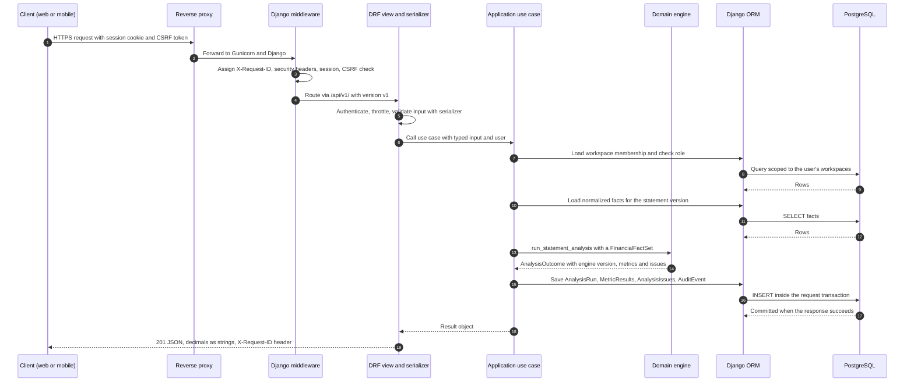
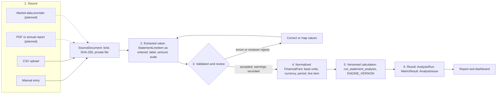

# Data Flow

How requests move through the backend, how financial statements become analysed
results, and how every number stays traceable to its source.

Status markers follow [SYSTEM_OVERVIEW.md](SYSTEM_OVERVIEW.md):
**Implemented**, **Designed (Phase 1)**, **Future**.

## 1. Request and data flow

Below is an authenticated API request as it will run in Phase 1: for example
`POST /api/v1/analysis-runs/` to analyse a validated statement version. The middleware,
versioning, authentication defaults, error envelope and transaction handling are
**implemented**. The application use case and the analysis endpoint are **designed**.



What happens when something fails:

| Failure | Behaviour | Status |
|---------|-----------|--------|
| Invalid input | Serializer raises a validation error → `400` with `{"error": {"code": "validation_error", "details": {...}}}` | Implemented (envelope) |
| Not authenticated / not permitted | `401` / `403` in the same envelope. Objects outside the user's workspaces return `404`, so their existence is not revealed. | Envelope implemented; scoping designed |
| Domain cannot compute a metric | Not an error: the metric is stored with `value = null` and an `Issue` (for example `missing_input`) | Implemented (engine) |
| Unexpected exception | Propagates to Django: logged with the request ID, transaction rolled back (`ATOMIC_REQUESTS`), generic JSON `500` | Implemented |
| Database unavailable | Request fails with JSON `500`. `GET /api/v1/health/` reports `503`. | Implemented |

Details: [ERROR_HANDLING_AND_OBSERVABILITY.md](ERROR_HANDLING_AND_OBSERVABILITY.md) and
[API_CONVENTIONS.md](../api/API_CONVENTIONS.md).

## 2. Financial statement processing pipeline

Every figure takes the same path, whatever its origin. Manual entry and CSV upload are
the Phase 1 sources. PDF extraction and provider data join the same pipeline later.



### Stage by stage

| Stage | What happens | Where | Status |
|-------|--------------|-------|--------|
| 1. Source | Each input becomes a `SourceDocument`: manual entry (a session record, no file) or a CSV file saved to private storage with its SHA-256 hash, original filename, uploader and timestamp. | `documents`, `infrastructure/storage` | Storage implemented; model designed |
| 2. Extracted value | Values are kept **exactly as provided** in `StatementLineItem`: source label, row reference, reported amount (`Decimal`), declared scale and currency. They are never overwritten. | `ingestion`, `financial_records` | Designed |
| 3a. Input validation | Structural checks at the boundary: parseable decimals (no floats, `NaN` or infinities), ISO currency code, period start ≤ end, known scale, known or mapped line-item code, no duplicate line items in one statement. A failure blocks the import with row-level errors. | Serializers and `ingestion` | Designed (domain primitives implemented) |
| 3b. Consistency validation | `domain.validation.validate_fact_set` checks sign conventions, the balance-sheet identity and the gross-profit subtotal, within a 0.1 % tolerance. Issues are **warnings**: they are recorded and shown but do not block analysis. | `domain.validation` | Implemented |
| 3c. Review | The user confirms the statement. Status moves `draft → validated`. For PDF extraction (Phase 2), a human must confirm each extracted value before it becomes a fact. | `financial_records` | Designed; PDF review Future |
| 4. Normalized fact | `normalize_amount` converts each value to base currency units with exact `Decimal` scaling. Each `FinancialFact` links back to its `StatementLineItem` and statement version. | `domain.financial_statements`, `financial_records` | Normalization implemented; persistence designed |
| 5. Versioned calculation | `run_statement_analysis` validates and computes every ratio in a fixed decimal context. The outcome carries `ENGINE_VERSION`, each metric's methodology and the exact inputs used. | `domain.calculations` | Implemented |
| 6. Result | The application layer stores an immutable `AnalysisRun` with a fingerprint of its inputs, plus `MetricResult` and `AnalysisIssue` rows. Reports reference runs and never copy numbers. | `analysis`, `reports` | Designed |

Single currency per analysis: the MVP never converts currencies. A statement set in mixed
currencies is rejected at input validation, pending the FX policy decision in
[ARCHITECTURE_DECISIONS.md](ARCHITECTURE_DECISIONS.md#decisions-pending-approval).
Conventions for scales, signs, rounding and missing data:
[FINANCIAL_CALCULATION_CONVENTIONS.md](../data/FINANCIAL_CALCULATION_CONVENTIONS.md).

## 3. CSV ingestion (Phase 1)

1. The client uploads a CSV through an authenticated endpoint. The endpoint rejects files
   above its own per-file limit before storing them. `FINLUME_MAX_REQUEST_BYTES` does not
   apply to file parts.
2. The file is hashed, then stored privately. Uploading an identical file to the same
   entity is detected by hash.
3. Rows are parsed as text and converted with `Decimal(str)`, never through `float`.
   Formula-like cells (starting with `=`, `+`, `-`, `@`) are treated as plain text and never
   evaluated. If any data is exported back to CSV, they are escaped on export.
4. All rows are validated before anything is written. The import is all-or-nothing inside
   one transaction.
5. The result is a `draft` statement version that the user reviews.

Imports are synchronous in the MVP: statement CSVs are small. Large or slow imports move
to background jobs in Phase 2.

## 4. Provenance and auditability

The provenance chain is designed so that any displayed number can be answered with
"where did this come from, and how was it computed?":

```text
MetricResult ──► AnalysisRun (engine_version, input fingerprint, created_by, created_at)
     │                 │
     └─ inputs ──► FinancialFact ──► StatementLineItem ──► FinancialStatement (version) ──► SourceDocument (sha256)
```

- **Immutability.** Analysis runs are never updated. Re-running, for example after a
  correction or an engine upgrade, creates a new run. Old runs stay reproducible from
  their stored inputs and engine version.
- **Restatements.** A corrected or restated statement is a new `FinancialStatement` version
  that `supersedes` the previous one, which moves to status `superseded`. Facts and the
  analysis runs built on the old version remain intact.
- **Input fingerprint.** Each run stores a hash of its canonicalised input facts, so two runs
  with the same fingerprint and engine version must produce identical results. Tests
  assert this determinism.
- **Audit events.** State changes (statement created, validated or superseded; analysis
  run; document uploaded or deleted; membership changed) emit an `AuditEvent` with actor,
  workspace, action, target `public_id`, timestamp and request ID. Audit metadata never
  contains financial values or document contents.
- **Request correlation.** The `X-Request-ID` ties log lines, audit events and the client's
  error report together.

Data model: [DATA_MODEL.md](../data/DATA_MODEL.md). Retention:
[DATA_LIFECYCLE_AND_RETENTION.md](../data/DATA_LIFECYCLE_AND_RETENTION.md).

## 5. Future integration points

| Integration | Phase | Entry point | Constraints |
|-------------|-------|-------------|-------------|
| Background jobs | 2 | `infrastructure/jobs/`: a job interface whose first implementation runs synchronously, and a Celery + Redis implementation when needed | Jobs receive IDs, never raw financial data in the message. They are idempotent and record status on the owning model. |
| PDF and annual-report extraction | 2 | A new source kind in the pipeline above. Extracted values land as `StatementLineItem`s with a confidence score and page reference. | Parsing runs in a worker, not the web process. **Every extracted value needs human confirmation** before it becomes a fact. |
| AI explanations | 3 | `infrastructure/providers/` adapters behind an application-defined interface, consumed by an `ai_explanations` module | Input is stored results, issues and methodology. Output is text linked to an `AnalysisRun`. The AI never produces or alters numbers. Off by default; local-model option. |
| Market data | 5 | Provider adapters writing prices with their source and retrieval time | Treated as a source like any other. Licensing terms respected. No paid or credentialed provider ships enabled. |
| Bank integrations | Unscheduled | — | Not planned until there is demand and a clear security model. |
