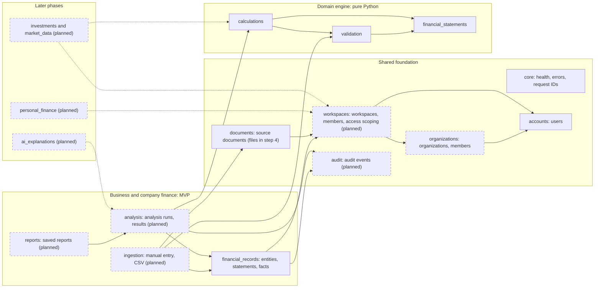

# Domain Boundaries

How Finlume's backend is divided into layers and modules, which way dependencies may
point, and when each planned module gets created. The goal is a modular monolith whose
boundaries are real enough that a module could be extracted later, without paying for
that extraction today.

## 1. Layers and dependency direction

```text
Presentation / API  ──►  Application  ──►  Domain
        │                    │
        └──────►  Infrastructure (ORM models, storage, providers, jobs)  ◄── implements ports defined by Application
```

| Layer | Location | May depend on | Must not depend on |
|-------|----------|---------------|--------------------|
| Presentation / API | `backend/apps/<module>/api/` (views, serializers, `urls.py`, DRF adapters), `backend/apps/<module>/admin.py`, and shared plumbing in `backend/api/` (error envelope, pagination, permissions) | Application, and Domain value types used for input/output | Another module's models or views |
| Application | `backend/services/` (Phase 1) | Domain, ports it defines, Django transactions and the ORM (querysets used directly; no repository layer while there is one database) | Presentation (no `Request`, no serializers, no `rest_framework` or `api` imports) |
| Domain | `backend/domain/` | Python standard library and other domain packages | Django, DRF, `apps`, `config`, `infrastructure`, I/O libraries |
| Infrastructure | `backend/infrastructure/` and Django models in `backend/apps/<module>/models.py` | Django, third-party libraries, Domain types | Presentation |

Rules:

1. **The domain is pure.** No ORM objects, HTTP requests, settings, clocks or network calls
   enter `domain/`. Inputs are plain values and frozen dataclasses such as
   `FinancialFactSet`. [`tests/test_architecture.py`](../../backend/tests/test_architecture.py)
   parses every domain module and fails the build on a forbidden import.
2. **Django models are persistence, not domain.** They live in their app. The application
   layer maps model rows to domain objects and domain results back to rows.
3. **Views stay thin.** A view authenticates the request, parses it with a serializer, calls
   one use case, and serializes the result. Business rules and arithmetic never live in
   views or serializers.
4. **Modules talk through the application layer.** The `analysis` module reads facts through
   a `financial_records` use case or query function, not by importing
   `financial_records.models` from its views.
5. **No cycles.** If two modules need each other, the shared concept moves down a layer, into
   a domain value type or a shared module.

Inside `domain/`, dependencies run in one direction:
`financial_statements` ← `validation` ← `calculations`.
`validation` uses statement types and `calculations` uses both. Nothing points back up.

## 2. Module map



Arrows point from a module to what it depends on. Dashed modules do not exist yet.
`core`, `accounts` and the three domain packages are implemented.

## 3. Implemented and planned modules

### 3.1 Django apps (`backend/apps/`)

| App | Status | Owns | Introduce when |
|-----|--------|------|----------------|
| `core` | **Implemented** | Shared Django integration: the abstract `PublicModel`, `ReadOnlyModelAdmin`, request IDs and the health endpoint. The error envelope and pagination moved to `backend/api/` | — |
| `accounts` | **Implemented** | Custom `User` model (`public_id`, case-insensitive unique email). It had to exist before the first migration. | — |
| `organizations` | **Implemented** (models and API) | `Organization` (the customer boundary) and `OrganizationMembership` (admin, member). Grants no workspace access ([ADR-0008](../decisions/ADR-0008-organizations-and-workspace-tenancy.md)) | MVP step 1a |
| `workspaces` | **Implemented** (models, backfill, API and the `recover_workspace_owner` command) | `Workspace` (personal or organization; the tenancy boundary), `WorkspaceMembership` (owner, editor, viewer) and `api/scoping.py`, the one helper every tenant view inherits | MVP step 1a |
| `financial_records` | **Implemented** (models and read-only admin; API in step 3) | `ReportingEntity`, `FinancialStatement` (versioned), `StatementLineItem`, `FinancialFact`, and the PostgreSQL composite keys that keep them in one workspace | MVP step 2a |
| `ingestion` | Conditional (Phase 1) | Only tables for import batches and row errors, if needed. The import workflow itself lives in `services/statement_analysis` and `services/documents` (§3.3) | CSV upload, if import batches need persisting |
| `documents` | **Implemented** (minimal: `manual_entry` only) | `SourceDocument` metadata. The file columns (SHA-256, private storage key) arrive with the first stored upload, the CSV file kept for provenance (step 4) | MVP step 2a |
| `analysis` | Planned (Phase 1) | `AnalysisRun` (immutable), `MetricResult`, `AnalysisIssue` | Persisting an engine run |
| `reports` | Planned (Phase 1; a separate app only if reports need their own persistence and endpoints) | `Report`: a saved, titled view over one or more analysis runs | Dashboard and report screens |
| `audit` | **Implemented** | `AuditEvent` (actor, pseudonymous actor label, action, target, request ID; no financial values) and `AuditEvent.record()` | — |
| `personal_finance` | Future (Phase 4) | Accounts, transactions, categories, budgets | Personal-finance phase |
| `investments`, `market_data` | Future (Phase 5) | Securities, listings, prices, portfolios, holdings | Investment phase |
| `ai_explanations` | Future (Phase 3) | Explanation requests and outputs linked to analysis runs | AI phase |

A planned app is created when the step that needs it begins. For MVP step 1, the maintainer
chose to scaffold the structure first (2026-10-27): `organizations`, `workspaces`, `audit`
and `backend/services/`. Their modules hold only a docstring stating their responsibility,
until PRs 1a–1d add the code. Apps for later steps are not created in advance.

### 3.2 Non-app packages

| Package | Status | Purpose | Introduce when |
|---------|--------|---------|----------------|
| `backend/domain/financial_statements` | **Implemented** | Currency, scale, period, line-item taxonomy, fact sets | — |
| `backend/domain/validation` | **Implemented** | Consistency checks returning `Issue`s | — |
| `backend/domain/calculations` | **Implemented** | Versioned ratio definitions, `run_statement_analysis` | — |
| `backend/infrastructure/storage` | **Implemented** | `PrivateFileSystemStorage`, system check `finlume.E001` | — |
| `backend/services/` | **Scaffolded** (MVP step 1) | The application layer: business workflows as plain typed functions, in one sub-package per **capability** ([§3.3](#33-service-capabilities-backendservices)). It never imports DRF (enforced by `tests/test_architecture.py`) | — |
| `backend/infrastructure/jobs/` | Future (Phase 2) | Job port with a synchronous implementation first, then Celery + Redis | When PDF ingestion or bulk imports exceed a request's time budget |
| `backend/infrastructure/providers/` | Future (Phases 3 and 5) | Market-data and AI adapters behind ports, disabled by default, credentials only from the environment | With the first real provider integration |

**Why `services/` and not `application/`.** ADR-0001 calls this layer "application". The
package is named `services/` (maintainer's choice, 2026-10-27), and the layer rules are the
same.

**Why `providers/` and `jobs/` do not exist yet.** No MVP feature calls an external
provider or needs asynchronous work. Their interfaces are designed with their first
consumer, so the abstraction fits a real need.

### 3.3 Service capabilities (`backend/services/`)

This is still a modular monolith, **not microservices**. Every capability runs inside the
one Django backend, with the one database and one deployment. A capability is a business
responsibility with a clear boundary, not a separate process.

| Layer | Responsibility |
|---|---|
| `domain/` | Financial calculations and business rules that run on their own: ratios, validation, normalisation. No Django or DRF |
| `services/` | Workflows that coordinate domain logic, database operations and external providers |
| `apps/` | Django integration: models, migrations, API views, serializers, URLs, admin and authentication adapters |

| Capability | Responsibility | Django apps it works with | Status |
|---|---|---|---|
| `access` | The shared authorization resolver used by every tenant endpoint and job | `workspaces`, `organizations` | Scaffolded (step 1a) |
| `accounts` | Registration and personal-workspace provisioning | `accounts`, `workspaces`, `audit` | Scaffolded (step 1b) |
| `organizations` | Organization lifecycle and membership | `organizations`, `workspaces`, `audit` | Implemented (step 1d) |
| `workspaces` | Workspace lifecycle, roles and ownership recovery | `workspaces`, `audit` | Scaffolded (step 1c) |
| `statement_analysis` | Statements and their entry, CSV mapping, normalisation, validation, ratio analysis through `domain.calculations`, and saved analyses and reports | `financial_records`, `analysis`, `reports` | MVP steps 2–5 |
| `documents` | Document intake (private storage, fingerprinting) and, in Phase 2, extraction with human review | `documents` | MVP step 4 (intake); Phase 2 (extraction) |
| `stock_research` | Company research, market data, valuation | `investments`, `market_data`, `infrastructure/providers` | Phase 5 |
| `portfolio_analysis` | Holdings, returns, risk and allocation | `investments` | Phase 5 |

Personal finance (Phase 4) and AI explanations (Phase 3) get their own capability when they
are designed.

Rules:

1. **A capability package is created with its first workflow,** never as an empty folder.
   The tenancy capabilities are the one exception, scaffolded on 2026-10-27 at the
   maintainer's request.
2. **Files inside a capability follow the work, not a template.** For example,
   `statement_analysis/` may grow `statements.py`, `validation.py`, `analysis.py` and
   `results.py`, but a file is split only when the code in it justifies the split.
3. **Workflows orchestrate, the domain calculates.** `statement_analysis` calls
   `domain.calculations.run_statement_analysis` and never re-implements a formula.
   `stock_research` will coordinate providers and valuation logic the same way.
4. **Financial capabilities do not import each other.** `stock_research` is not mixed into
   `statement_analysis` merely because both deal with finance. Shared needs go through
   `access` or move down into `domain`. An architecture test is added when the second
   financial capability arrives.
5. **The `ingestion` app is folded into these capabilities.** CSV mapping is part of
   `statement_analysis`, and file intake is part of `documents`. The planned `ingestion` app
   (§3.1) is created only if import batches need their own tables.

### 3.4 Client applications (repository root)

`apps/web/` (React + TypeScript + Vite) and `apps/mobile/` (React Native + Expo) exist as
shells. They have a live health check, empty states for every feature the backend does not
offer yet, and, on the web only, a clearly labelled synthetic sample dashboard. Data
features follow the backend APIs: web in Phase 1, mobile after the v1 API stabilises.
The root `apps/` (clients) and `backend/apps/` (Django apps) share a name but are unrelated,
and each client has its own README and lock file. Stack:
[ADR-0006](../decisions/ADR-0006-client-stack.md); overview:
[Frontend applications](../development/FRONTEND.md).

## 4. Why personal, business and investment finance are separate modules

They look similar ("money in, money out") but differ where it matters:

| Aspect | Business / company statements | Personal finance | Investments |
|--------|-------------------------------|------------------|-------------|
| Core record | Period totals per line item (income statement, balance sheet, cash flow) | Individual transactions on accounts | Positions, trades and market prices |
| Time model | Reporting periods (annual, quarterly) and as-of dates | Transaction dates, monthly budgets | Trade dates, daily prices |
| Source | Statements, annual reports, CSV | Bank or card exports, manual entry | Broker statements, market-data providers |
| Correctness rules | Accounting identities, subtotals, restatements | Categorisation, transfers between own accounts | Corporate actions, cost basis, FX |
| Privacy | Possibly public company data, or private business data | Highly personal | Personal holdings plus public market data |

Forcing them into one generic "financial record" table would weaken constraints, blur
permissions and make every query defensive. Each therefore gets its own module and schema.

**What is shared**, because the concepts genuinely align:

- Identity and tenancy: `accounts.User`, `organizations.Organization`,
  `workspaces.Workspace` and `WorkspaceMembership`. A workspace is either personal or owned by
  an organization. Every tenant module scopes its data through `workspaces.scoping`.
- Source documents and private storage (`documents`, `infrastructure/storage`).
- Audit events (`audit`).
- Domain value types: `Currency`, `Scale`, `ReportingPeriod`, the `Decimal` precision
  policy, and `Issue` / `Severity` for reporting validation results.
- Cross-cutting HTTP concerns (`core`).

Shared code moves into a common place only when a second module actually needs it.

## 5. Checklist for adding a module

1. Confirm the module has a distinct data model, permission rule or business rule.
   Otherwise extend an existing module.
2. Put calculations and rules in `domain/` first, with unit tests and no Django.
3. Create the Django app with its first real model, migration, admin registration and API
   tests.
4. Put its endpoints in `apps/<app>/api/` and add `apps.<app>.api.urls` to [`config/api_v1.py`](../../backend/config/api_v1.py). Put its workflows in `services/<capability>/`.
5. Update this document's tables and [DATA_MODEL.md](../data/DATA_MODEL.md).
6. Write an ADR if the module introduces a new dependency, datastore or boundary rule.
