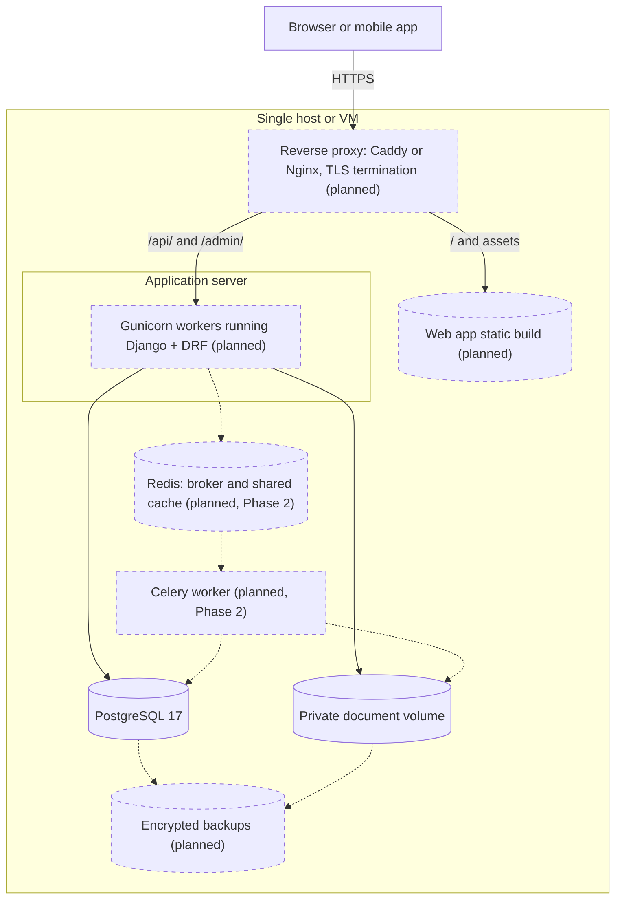

# Scalability and Deployment

How Finlume runs locally, how a self-hoster deploys it, how a future production
deployment scales, and which infrastructure is deliberately left out.

**What exists today:** production-grade Django settings (`config.settings.production`),
ASGI and WSGI entry points, a health endpoint, and a `compose.yaml` that runs **only a local
development PostgreSQL**. Container images, a production compose file, the application
server and a reverse-proxy configuration arrive with the deployment work after the MVP is
functional. Nothing in this document describes services that are running today unless it
says so.

## 1. Typical deployment topology (target)

- The reverse proxy serves the built web app and proxies `/api/` and `/admin/` to Django
  on the **same origin**. Session cookies and CSRF then work without CORS.
- The proxy terminates TLS and sets `X-Forwarded-Proto`. Only then should a deployment set
  `FINLUME_TRUST_PROXY_SSL_HEADER=true`.
- PostgreSQL and the private document volume are reachable only from the application
  host. They are never exposed publicly, and documents are never served by the proxy.
- Gunicorn is **not yet a dependency**. It is added to `pyproject.toml` with the deployment
  phase, because nothing in the repository uses it today. ASGI (`config/asgi.py`) remains
  available if streaming or async views justify it later.
- Redis and the Celery worker exist only once Phase 2 introduces background jobs.

## 2. Environments

### 2.1 Local development — Implemented

| Option | How | When |
|--------|-----|------|
| Default | Copy `.env.example` to `.env`, run `docker compose up -d db` (PostgreSQL 17 on `127.0.0.1:55432`), then run Django on the host, or `scripts/dev.ps1` / `scripts/dev.sh` | All development. Development settings require PostgreSQL and fail clearly without its settings |
| Own server | Point `POSTGRES_*` in `.env` at a dedicated database on your own PostgreSQL 14+ server | When Docker is not wanted |
| Throwaway trial | `FINLUME_DB_ENGINE=sqlite` (explicit opt-in, warning `finlume.W001`) | Trying the project without a database server; never for real data |

SQLite does not preserve decimal precision like PostgreSQL `numeric` and must never hold
real financial data. CI always runs the test suite against PostgreSQL 17. Full steps:
[LOCAL_SETUP.md](../development/LOCAL_SETUP.md).

### 2.2 Self-hosted — Future packaging, settings implemented

The intended self-hosted shape is the topology above on one machine, delivered as a
production compose file and container images. Requirements already enforced by
`config.settings.production`:

- `DJANGO_SECRET_KEY` set and at least 50 characters.
- `DJANGO_ALLOWED_HOSTS` set.
- `FINLUME_DB_ENGINE=postgresql`: startup fails on anything else.
- HTTPS redirect on by default, secure session and CSRF cookies.
- HSTS configurable (`FINLUME_HSTS_*`), off until the operator confirms HTTPS works
  everywhere. `manage.py check --deploy` warns until it is set.
- `FINLUME_PRIVATE_STORAGE_ROOT` outside any web-served path (checked by `finlume.E001`).

Self-hosters own their backups, upgrades and TLS certificates. Upgrade procedure: back up
the database and documents, deploy the new version, run `manage.py migrate`, then check
`GET /api/v1/health/`.

### 2.3 Future production (hosted instance) — Future

Whether an official hosted instance will exist is an open decision
([ARCHITECTURE_DECISIONS.md](ARCHITECTURE_DECISIONS.md#decisions-pending-approval)). If it
does, it adds: managed PostgreSQL with point-in-time recovery, object storage with private
buckets for documents, centralised logs and error tracking, uptime monitoring on the
health endpoint, and documented incident response.

## 3. Scaling path

Finlume's workload is interactive analysis on modest data volumes. A single, well-run
PostgreSQL and a few application processes go a long way. Scale in this order, and only
when measurements show the need:

| Step | Trigger | Change |
|------|---------|--------|
| 1 | Baseline | One host: proxy, Gunicorn (workers ≈ 2 × CPU cores + 1), PostgreSQL |
| 2 | Slow pages | Fix queries first: `select_related` / `prefetch_related`, indexes from [DATABASE_CONVENTIONS.md](../data/DATABASE_CONVENTIONS.md), pagination (already the default) |
| 3 | More than one application process or host | Add a **shared cache** (Redis). DRF throttling currently uses the per-process local-memory cache, so limits are not shared across processes. Sessions stay in the database. |
| 4 | Long-running work (PDF parsing, bulk imports) | Background jobs via the `infrastructure/jobs` port with Celery workers, scaled separately from web processes |
| 5 | Database CPU or connection pressure | Vertical scaling, then a connection pooler (PgBouncer), then read replicas for reporting queries |
| 6 | Many horizontal app hosts | Move documents from the filesystem volume to private object storage (an adapter swap behind `STORAGES`). Run the app statelessly behind a load balancer. |

Calculations are pure functions over in-memory fact sets, so they scale with application
processes. Analysis runs are immutable, so they can be cached safely by
`(input fingerprint, engine version)` if that is ever needed.

## 4. Deliberately not added

| Not adding | Why | Revisit when |
|------------|-----|--------------|
| Microservices | A modular monolith ([ADR-0001](../decisions/ADR-0001-modular-monolith.md)) gives clear boundaries without network calls, distributed transactions or multi-service operations | A module has a measured, independent scaling or isolation need |
| Kubernetes | Too much operational weight for self-hosters and for an early project. One host with Compose fits the expected load. | A hosted instance needs multi-node orchestration |
| Kafka or other event streaming | No high-volume event streams exist. Background jobs cover asynchronous needs. | Event-driven integrations at scale |
| Redis (today) | No feature needs a broker or shared cache yet | Phase 2 jobs, or more than one application process (step 3 above) |
| Separate calculation service | The engine is a pure Python package that runs in-process | Never by default; see ADR-0001 |

## 5. Operational endpoints and signals

- `GET /api/v1/health/` is public and unthrottled. It returns `200` with
  `{"status": "ok", "checks": {"database": "ok"}}`, or `503` when the database is
  unreachable. It never reveals versions, hosts or error text. Use it for load-balancer
  readiness and uptime checks.
- Logs go to stdout with a `request_id` on every line. SQL logging stays at `WARNING`,
  because queries can contain financial values.
- More: [ERROR_HANDLING_AND_OBSERVABILITY.md](ERROR_HANDLING_AND_OBSERVABILITY.md).
