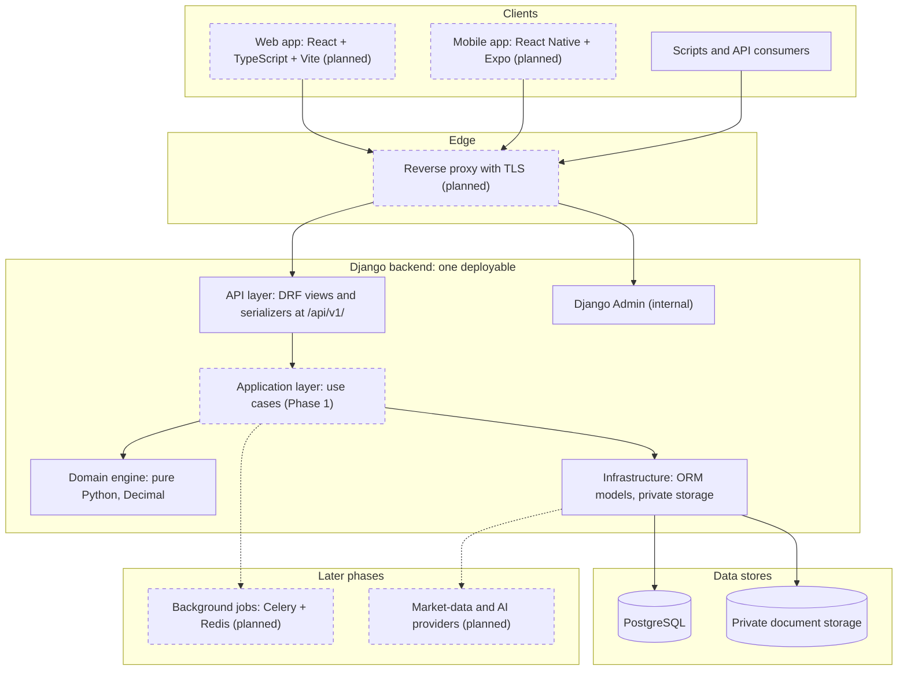

# System Overview

Finlume is an open-source financial intelligence platform. This document describes the
system as a whole: its clients, the backend, the financial calculation engine, storage,
and the integration points reserved for later phases.

Every component in this document has one of three statuses:

| Status | Meaning |
|--------|---------|
| **Implemented** | Exists in the repository today and is covered by tests or CI. |
| **Designed (Phase 1)** | Specified in these documents; built during the MVP phase. |
| **Future** | Direction only. Introduced in a later phase when a real need exists. |

Phase definitions live in [PRODUCT_SCOPE.md](../product/PRODUCT_SCOPE.md).

## 1. Architecture at a glance

Finlume is a **modular monolith** ([ADR-0001](../decisions/ADR-0001-modular-monolith.md)):
one Django + Django REST Framework (DRF) deployable that exposes a versioned REST API,
backed by PostgreSQL, with financial arithmetic isolated in a framework-independent Python
domain package. Web and mobile clients consume the same `/api/v1/` API.

Dashed boxes are not built yet. The Django backend, the domain engine, the private storage
adapter, and the PostgreSQL configuration exist today.

## 2. Components

### 2.1 Web and mobile clients — Future (web in Phase 1)

| Client | Stack ([ADR-0006](../decisions/ADR-0006-client-stack.md)) | Status |
|--------|-------|--------|
| Web | React, TypeScript, Vite, TanStack Query, React Hook Form + Zod, Apache ECharts, Tailwind CSS + shadcn/ui | Shell in `apps/web/`: live health check, empty states, synthetic sample dashboard. Data features arrive in Phase 1 |
| Mobile | React Native + Expo | Shell in `apps/mobile/`: live health check. Data features after the v1 API stabilises post-MVP |

Both clients exist as shells ([Frontend applications](../development/FRONTEND.md)). They are
thin presentation layers over the same versioned API: no financial arithmetic happens in a
client. Clients format values the API
returns (monetary values arrive as decimal strings) but never recompute them.

An OpenAPI schema (for example via `drf-spectacular`) is planned in Phase 1 so both clients
can generate typed API bindings. It is not yet a dependency.

### 2.2 Django + DRF API — Implemented (foundation)

- `config/urls.py` mounts the API with `re_path(r"^api/(?P<version>v1)/", ...)` and DRF's
  `URLPathVersioning` (`ALLOWED_VERSIONS = ["v1"]`). Each app contributes its URLs through
  [`config/api_v1.py`](../../backend/config/api_v1.py).
- `GET /api/v1/health/` is the only endpoint so far: public, unthrottled, outside the request
  transaction. It returns `{"status": ..., "checks": {"database": ...}}` with `200` or `503`.
- Every response carries an `X-Request-ID`. Errors use one JSON envelope:
  `{"error": {"code", "message", "details", "request_id"}}`. Unknown URLs and server errors
  also answer in JSON.
- Defaults are secure: every endpoint requires authentication unless it explicitly opts
  out. Throttling, pagination, JSON-only rendering in production and decimal-as-string
  serialization are configured globally.

Conventions: [API_CONVENTIONS.md](../api/API_CONVENTIONS.md).

### 2.3 Authentication and authorization boundaries

| Boundary | Mechanism | Status |
|----------|-----------|--------|
| Identity | Custom `accounts.User` (`public_id` UUID, case-insensitive unique email) | Implemented |
| Web authentication | Django session + CSRF, same origin through the reverse proxy (Vite dev proxy locally, so no CORS dependency) | Designed (Phase 1) |
| Mobile authentication | Token-based strategy, decided in a future ADR | Future |
| Tenancy | `Workspace` (personal or business) is the ownership and permission boundary | Designed (Phase 1) |
| Object-level authorization | `WorkspaceMembership` role (owner, editor, viewer) checked by one resolver in `services/access/` and enforced by workspace-scoped querysets ([ADR-0008](../decisions/ADR-0008-organizations-and-workspace-tenancy.md)) | Designed (Phase 1) |
| Internal administration | Django Admin at a configurable path (`FINLUME_ADMIN_URL_PATH`), staff only | Implemented |

Details: [SECURITY_AND_PRIVACY.md](SECURITY_AND_PRIVACY.md).

### 2.4 Layers

| Layer | Location | Responsibility | Status |
|-------|----------|----------------|--------|
| Presentation / API | `backend/apps/*` (views, serializers, URLs, admin) | HTTP, input parsing, output shaping | Implemented (core, accounts) |
| Application | `backend/services/` | Use cases, transactions, authorization orchestration, mapping between ORM models and domain objects | Scaffolded (Phase 1) |
| Domain | `backend/domain/` | Financial concepts, validation rules and calculations. Pure Python, no Django | Implemented (engine 0.1.0) |
| Infrastructure | `backend/infrastructure/` and Django models in `backend/apps/*` | Persistence, private storage, later jobs and external providers | Implemented (storage) |

Rules and the module map: [DOMAIN_BOUNDARIES.md](DOMAIN_BOUNDARIES.md).

### 2.5 Financial calculation engine — Implemented (engine 0.1.0)

The engine lives in `backend/domain/` as ordinary Python packages
([ADR-0003](../decisions/ADR-0003-deterministic-calculation-engine.md)):

- `domain.financial_statements` defines `Currency`, `Scale`, `ReportingPeriod`, the `LineItem`
  taxonomy and `FinancialFactSet`, a set of normalized facts for one entity, one period and
  one currency.
- `domain.validation` provides consistency checks (sign conventions, balance-sheet identity,
  gross-profit subtotal). Each check returns `Issue` objects and never modifies data.
- `domain.calculations` holds versioned ratio definitions. `run_statement_analysis`
  returns an `AnalysisOutcome` stamped with `ENGINE_VERSION`.

All arithmetic uses `decimal.Decimal` in an explicit context (precision 34, half-even
rounding, results kept to six decimal places). Missing inputs are never treated as zero.
A test fails the build if any domain module imports Django, DRF or an outer layer.
Conventions: [FINANCIAL_CALCULATION_CONVENTIONS.md](../data/FINANCIAL_CALCULATION_CONVENTIONS.md).

AI components may later *explain* stored results. They are never the source of a
calculated number.

### 2.6 Financial data ingestion and validation — Designed (Phase 1)

The MVP accepts **manual entry** and **CSV upload** of financial statements. Raw values are
stored exactly as entered, normalized to base units (`normalize_amount`, exact `Decimal`
scaling), validated by the domain checks, and then analysed. PDF and annual-report
extraction (Phase 2) feeds the same pipeline through a human review step. See
[DATA_FLOW.md](DATA_FLOW.md).

### 2.7 PostgreSQL persistence — Implemented (configuration)

PostgreSQL is the only supported production database. Its `numeric` type preserves
decimal precision. Settings build the connection from `FINLUME_DB_ENGINE` and `POSTGRES_*`
variables, with `ATOMIC_REQUESTS`, persistent connections (`CONN_MAX_AGE=60`) and connection
health checks. Development defaults to PostgreSQL as well. SQLite is an explicit opt-in
(`FINLUME_DB_ENGINE=sqlite`) for throwaway trials, and the fast default for isolated local
tests (`FINLUME_TEST_DB_ENGINE`). Production settings refuse it. CI runs the test suite against
PostgreSQL 17.

The only schema today is the custom user model. The Phase 1 schema is designed in
[DATA_MODEL.md](../data/DATA_MODEL.md).

### 2.8 Private document storage — Implemented (adapter)

`infrastructure.storage.private.PrivateFileSystemStorage` writes files owner-only (`0o600`)
and raises `PublicURLNotAllowedError` from `url()`. Both the `default` and
`private_documents` storage aliases use it, so nothing uploaded can land in a publicly
served directory. A Django system check (`finlume.E001`) fails if the private root sits
inside a static or media root. Documents will be served only through authenticated,
ownership-checked API views ([ADR-0005](../decisions/ADR-0005-private-document-storage.md)).

### 2.9 Background processing — Future (Phase 2)

Every MVP operation is synchronous. Phase 2 introduces a job interface in
`infrastructure/jobs/`, with a synchronous implementation first. Celery + Redis are added
only when PDF ingestion or bulk imports need asynchronous execution.

### 2.10 Optional AI and market-data providers — Future (Phases 3 and 5)

Providers sit behind interfaces in `infrastructure/providers/`. They are **off by default**.
No credentials are stored in the repository: self-hosters supply their own through
environment variables. AI explanations receive stored, verified results and their
provenance as input. A local-model option keeps data on the instance. Market data
(Phase 5) is stored with its source and retrieval timestamp, like any other source.

### 2.11 Data provenance and auditability — Designed (Phase 1)

Every number can be traced back to its source:
`Source → Extracted value → Validation/review → Normalized financial fact → Versioned calculation → Result`.
Analysis runs are immutable and record the engine version and a fingerprint of their
inputs. Restatements create new statement versions instead of overwriting old ones.
`AuditEvent` records who did what, without copying financial values into audit metadata.
See [DATA_FLOW.md](DATA_FLOW.md#4-provenance-and-auditability).

## 3. Environments

| Environment | Settings module | Database | Status |
|-------------|-----------------|----------|--------|
| Local development | `config.settings.development` (default for `manage.py`) | PostgreSQL (via `compose.yaml` on port 55432, or your own server); SQLite only as an explicit opt-in | Implemented |
| Tests and CI | `config.settings.test` | `FINLUME_TEST_DB_ENGINE`: SQLite locally by default, PostgreSQL 17 in CI (enforced) | Implemented |
| Self-hosted or production | `config.settings.production` (default for ASGI/WSGI) | PostgreSQL (enforced) | Settings implemented; deployment packaging Future |

Deployment topology and scaling: [SCALABILITY_AND_DEPLOYMENT.md](SCALABILITY_AND_DEPLOYMENT.md).
Local setup: [LOCAL_SETUP.md](../development/LOCAL_SETUP.md).

## 4. Related documents

- [ARCHITECTURE_DECISIONS.md](ARCHITECTURE_DECISIONS.md) — decision index
- [DOMAIN_BOUNDARIES.md](DOMAIN_BOUNDARIES.md) — modules, layers, dependency rules
- [DATA_FLOW.md](DATA_FLOW.md) — requests, the statement pipeline, provenance
- [SECURITY_AND_PRIVACY.md](SECURITY_AND_PRIVACY.md) and [THREAT_MODEL.md](THREAT_MODEL.md)
- [ERROR_HANDLING_AND_OBSERVABILITY.md](ERROR_HANDLING_AND_OBSERVABILITY.md)
- [TESTING_STRATEGY.md](TESTING_STRATEGY.md)
- [OPEN_SOURCE_GOVERNANCE.md](OPEN_SOURCE_GOVERNANCE.md)
