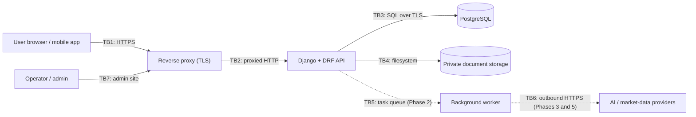

# Threat Model

This is a STRIDE-based threat model for Finlume. It covers the Phase 0 code in
the repository and the designs for Phases 1–5. Review it whenever a phase adds
a trust boundary: a new client, file ingestion, background jobs, or an
external provider.

Status values:

- **Implemented**: the mitigation is in code now.
- **Planned (Phase N)**: the mitigation will ship with that phase.
- **Open**: the mitigation still needs a decision.

Phases are defined in [PRODUCT_SCOPE.md](../product/PRODUCT_SCOPE.md); controls are detailed in [SECURITY_AND_PRIVACY.md](SECURITY_AND_PRIVACY.md).

## 1. Assets

| ID | Asset | Why it matters |
|---|---|---|
| A1 | Financial records: statements, line items, normalised facts, analysis results | Confidential business or personal information, and the basis of decisions |
| A2 | Source documents: CSV uploads now, PDFs and annual reports later | They often contain more than the extracted figures (names, account numbers) |
| A3 | Credentials and sessions: password hashes, session cookies, future API tokens and provider keys | Whoever holds them gets full access to A1 and A2 |
| A4 | Calculation integrity: engine code, methodology, engine version, the input-to-result link | Users act on results; silently wrong numbers cause real harm |
| A5 | Audit trail: who changed what and when (Phase 1) | Needed to detect and investigate misuse |
| A6 | Availability of the service and database | Self-hosted instances often run on small machines |

## 2. Trust boundaries

- **TB1, client to edge:** everything from clients is untrusted (bodies, headers, uploaded files, `X-Request-ID`).
- **TB2, proxy to app:** `X-Forwarded-Proto` is trusted only when `FINLUME_TRUST_PROXY_SSL_HEADER=true`.
- **TB3 and TB4, app to data stores:** trusted infrastructure under operator control.
- **TB5 and TB6, future:** document content and provider responses are untrusted input, even when they arrive through our own worker.
- **TB7, administrative access:** highly privileged; the admin site is reachable only through the same proxy.

## 3. Threats and mitigations

| # | STRIDE | Asset | Threat | Mitigation | Status |
|---|---|---|---|---|---|
| T1 | Elevation / Info disclosure | A1, A2 | **Cross-workspace IDOR:** a user changes an ID in a URL to read another workspace's data | Querysets scoped by the user's workspaces; role checks in the application layer; 404 for foreign objects; a cross-workspace test per endpoint | Planned (Phase 1) |
| T2 | Info disclosure | A1 | **Enumeration** of users or records through sequential IDs | API exposes only `public_id` UUIDs; integer primary keys stay internal | Implemented for `User`; required pattern for all Phase 1 models |
| T3 | Tampering | A1 | **CSRF:** a malicious site triggers state-changing requests with the user's session | Django `CsrfViewMiddleware`, DRF `SessionAuthentication` enforces CSRF; `SameSite=Lax` cookies; same-origin SPA (no CORS) | Implemented (middleware and settings); verified per endpoint in Phase 1 |
| T4 | Spoofing | A3 | **Credential brute force or stuffing** | Strong password validators (min. 12, common list); DRF throttles (`anon` 60/min, `user` 1000/h); dedicated login throttle and backoff; MFA | Validators and throttles implemented; login throttle Planned (Phase 1); MFA Planned (after Phase 1) |
| T5 | Spoofing | A3 | Session theft over plain HTTP or through script access | `SESSION_COOKIE_SECURE`, `CSRF_COOKIE_SECURE`, HTTP-only session cookie, SSL redirect, HSTS (operator-enabled) | Implemented (HSTS is operator opt-in) |
| T6 | Tampering / Info disclosure | A1, A3 | **XSS in the web client** steals data or acts as the user | React escaping by default; no `dangerouslySetInnerHTML` for user or document content; CSP; JSON-only API; `nosniff` | `nosniff` and JSON-only implemented; CSP and client rules Planned (Phase 1) |
| T7 | Elevation / DoS | A2, A6 | **Malicious file upload:** a polyglot file, oversized file, parser exploit or path traversal | Per-file size limits in upload endpoints plus a reverse-proxy body limit (`FINLUME_MAX_REQUEST_BYTES` caps non-file request data only); content-based type detection; server-generated storage names; private storage; PDF parsing in a sandboxed worker with limits | CSV uploads (step 4): a 1 MiB per-file limit checked before storing, a row cap, content-based UTF-8 detection, random server-side storage keys, private storage, in-memory handling only. The reverse-proxy limit and PDF sandboxing are Planned (step 8, Phase 2) |
| T8 | Tampering | user machines | **CSV/formula injection** in exported files runs in the user's spreadsheet application | Escape cells starting with `=`, `+`, `-`, `@`, tab or CR on export | Planned (Phase 1, with exports) |
| T9 | DoS | A6 | **Decompression or archive bombs** (ZIP, XLSX) | Do not accept archives initially; cap uncompressed size, entry count and compression ratio if XLSX is added | Planned (when XLSX is added) |
| T10 | Info disclosure | A2 | **Direct access to stored documents** through a public URL or web root | `PrivateFileSystemStorage.url()` raises; no `MEDIA_URL` route; system check `finlume.E001` blocks a private root inside public roots; owner-only file modes | Implemented |
| T11 | Elevation / Info disclosure | A1, A3 | **SSRF** through future provider integrations or URL-based document import | Providers are fixed, operator-configured endpoints; no user-supplied URLs fetched by the server; outbound allow-list; workers without access to internal metadata endpoints | Planned (Phases 3 and 5) |
| T12 | Tampering / Info disclosure | A4, A1 | **Prompt injection** through document text manipulates AI explanations or exfiltrates data | AI never computes numbers or writes data; it receives stored metric results, not raw documents; output must cite stored results; AI is off by default and runs on a local model when configured; the UI labels AI text as generated | Planned (Phase 3) |
| T13 | Tampering | A4 | **Data or result tampering** changes calculations unnoticed | Deterministic engine; `ENGINE_VERSION` and methodology stored with each result; analysis runs immutable; recomputation detects drift; audit events on data changes; restatements create new versions instead of overwriting | Engine determinism and versioning implemented; persistence rules Planned (Phase 1) |
| T14 | Tampering | A4 | **Silent numeric errors:** float rounding, ambient decimal context, unit or scale mix-ups | `Decimal` only (floats rejected); exact scale normalisation that traps inexact results; explicit calculation context (precision 34, half-even); explicit currency, period and scale; a missing value is never zero | Implemented (`domain/`) |
| T15 | Tampering | all | **Supply-chain compromise** or vulnerable dependency | Hash-pinned locks; `pip-audit` in CI; lock-consistency CI job; minimal dependencies; read-only CI token | Implemented; Dependabot update PRs configured. The dev-only `filelock` exception closed when the Python floor was raised to 3.12 |
| T16 | Info disclosure | A1, A3 | **Log leakage** of financial values, credentials or errors | No financial values or PII in logs (rule); SQL logging pinned at WARNING; generic 500 body; validated request IDs (no log injection) | Implemented (settings and envelope); content rule enforced in review |
| T17 | Info disclosure | A1 | **Error responses leak internals** (stack traces, SQL) | Unified JSON error envelope; `server_error` and `not_found` handlers; `DEBUG=False` outside development | Implemented |
| T18 | Repudiation | A5 | A user denies having changed or deleted data | `AuditEvent` with actor, workspace, action, object `public_id`, timestamp and request ID; append-only from the application | Planned (Phase 1) |
| T19 | Elevation | all | **Misconfigured self-host:** `DEBUG` on, weak secret, SQLite, open host header, HTTP | Production settings refuse a missing or short secret, missing `ALLOWED_HOSTS` and non-PostgreSQL databases; secure cookies and SSL redirect by default; `check --deploy` documented | Implemented (tested in `tests/config/test_settings.py`) |
| T20 | DoS | A6 | Request floods or very large bodies | Request size cap; DRF throttles; proxy-level rate limiting and timeouts | Throttles and size cap implemented; proxy guidance Planned (with the deployment guide) |
| T21 | DoS | A6 | **Throttle bypass across workers:** the default local-memory cache counts per process, so N workers allow N× the limit | Configure a shared cache (Redis) for throttling in multi-process deployments | **Open** (no `CACHES` configured yet) |
| T22 | Elevation | A1–A3 | Compromised admin account | Strong passwords; MFA for staff; admin behind the same TLS proxy; restrict by network where possible; audit events | Partly implemented (passwords); MFA and audit Planned |
| T23 | Info disclosure | A1, A2 | Backups or database disks stolen | Operator encrypts disks and backups; PostgreSQL TLS for remote connections | Operator responsibility (documented) |
| T24 | Info disclosure | A1 | Real financial data committed to the public repository (fixtures, screenshots) | `.gitignore` covers `.env`, local databases, `backend/var/`, uploads and exports; fictional-data-only rule in the PR template and CONTRIBUTING | Implemented |

## 4. Residual risks and open items

- **Mobile authentication** is undecided (T4 and T5 for mobile). An ADR is required before mobile work starts.
- **Shared throttle cache** (T21) is needed before running more than one worker process.
- **Malware scanning** of uploads is optional and its default is undecided.
- **Security contact:** GitHub private vulnerability reporting must be enabled on the repository by the maintainer ([OPEN_SOURCE_GOVERNANCE.md](OPEN_SOURCE_GOVERNANCE.md)).
