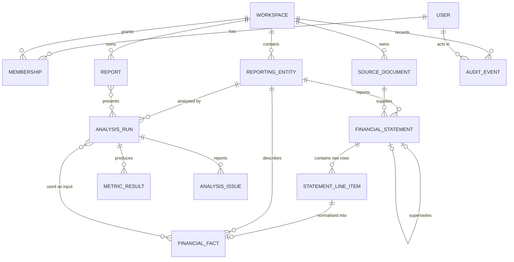

# Data Model

Conceptual and logical data model for Finlume. Status markers:

- **Implemented**: the table exists in a migration today.
- **MVP**: designed for Phase 1, but not yet a model or migration.
- **Future**: direction only; the design will be revisited before implementation.

Physical conventions (types, naming, indexes, constraints) are defined in
[Database conventions](DATABASE_CONVENTIONS.md). Deletion and retention behaviour is in
[Data lifecycle and retention](DATA_LIFECYCLE_AND_RETENTION.md). How the stored numbers are
calculated is in [Financial calculation conventions](FINANCIAL_CALCULATION_CONVENTIONS.md).

## 1. Design principles

1. **Separate domains get separate tables.** Business statements, personal transactions and investment holdings have different rules, permissions and lifecycles. They are not forced into one generic "financial record" table.
2. **The workspace is the tenancy boundary.** Every tenant-owned row is reachable from exactly one workspace, and frequently queried tables carry a direct `workspace` foreign key so authorization filters are simple and indexable.
3. **Raw input is kept separate from normalised facts.** What the user entered or uploaded is stored as-is. Normalised facts are derived from it and point back to it.
4. **Provenance is never broken.** Foreign keys along the provenance chain use Django's `on_delete=RESTRICT`. A source, statement version or fact cannot be deleted while something outside the same deletion still references it. Unlike `PROTECT`, `RESTRICT` still lets a whole workspace (or a user's personal workspace) be deleted in one cascade, because every referencing row is deleted with it. `PROTECT` would raise `ProtectedError` in that case, even inside a correct cascade.
5. **Analysis results are append-only.** A completed analysis run is never edited. A correction produces a new statement version and a new run.
6. **Only what the MVP needs is implemented.** Future entities are documented here so the MVP design does not block them, but they get no tables yet.

## 2. Entity overview

| Entity | Planned app | Status | Purpose |
|--------|-------------|--------|---------|
| `User` | `accounts` | **Implemented** | Authentication identity |
| `Workspace` | `organizations` | MVP | Tenancy and permission boundary (personal or business) |
| `Membership` | `organizations` | MVP | User's role in a workspace |
| `ReportingEntity` | `financial_records` | MVP | The business, person or company whose statements are analysed |
| `SourceDocument` | `documents` | MVP | Where figures came from: manual entry session or uploaded file |
| `FinancialStatement` | `financial_records` | MVP | One statement for one entity, one period, one version |
| `StatementLineItem` | `financial_records` | MVP | A raw row exactly as entered or uploaded |
| `FinancialFact` | `financial_records` | MVP | A verified, normalised figure in base currency units |
| `AnalysisRun` | `analysis` | MVP | One immutable execution of the calculation engine |
| `MetricResult` | `analysis` | MVP | One metric value produced by a run |
| `AnalysisIssue` | `analysis` | MVP | A validation or calculation issue produced by a run |
| `Report` | `reports` | MVP | A saved, titled view of one or more analysis runs |
| `AuditEvent` | `audit` | MVP | Who did what, when; contains no financial values |
| `Organization` | `organizations` | Future | Groups several business workspaces (for example, a group of companies) |
| `ExtractionCandidate` | `ingestion` | Future (Phase 2) | A value extracted from a PDF, awaiting human review |
| `ExplanationRecord` | `explanations` | Future (Phase 3) | An AI explanation and the stored results it cites |
| Personal finance entities | `personal_finance` | Future (Phase 4) | `Account`, `Transaction`, `Category`, `Budget` |
| Investment entities | `investments`, `market_data` | Future (Phase 5) | `Security`, `Listing`, `PriceBar`, `Portfolio`, `Holding`, `Trade`, provider snapshots |

## 3. Relationships (MVP)



## 4. Entities

Every entity below also has the standard columns from
[Database conventions](DATABASE_CONVENTIONS.md#standard-columns): `id` (internal),
`public_id` (UUID, used in the API), `created_at` and `updated_at`. They are not repeated in
each table. An append-only entity has no `updated_at`.

### 4.1 User (Implemented)

App `accounts`, table `accounts_user`. Extends Django's `AbstractUser`.

| Field | Type | Notes |
|-------|------|-------|
| `id` | bigint PK | Internal; never exposed through the API |
| `public_id` | uuid, unique | API identifier |
| `username` | varchar(150), unique | Django default |
| `email` | varchar(254) | Unique **case-insensitively** through `UniqueConstraint(Lower("email"), name="accounts_user_email_ci_unique")` |
| `password` | varchar(128) | Django password hash; never logged |
| `first_name`, `last_name`, `is_staff`, `is_active`, `is_superuser`, `last_login`, `date_joined` | Django defaults | |

Ownership: a user owns no financial data directly. Data belongs to workspaces, and users act
on it through memberships.

### 4.2 Workspace (MVP)

The tenancy and permission boundary. For the MVP it replaces a separate
"organization" concept. A future `Organization` may group several business workspaces.

| Field | Type | Notes |
|-------|------|-------|
| `name` | varchar(200) | |
| `kind` | varchar(16) | `personal` or `business` (CHECK) |
| `base_currency` | char(3), nullable | Default currency for new statements; display only, no conversion |
| `personal_owner` | FK → User, `CASCADE`, nullable, unique | Set only for personal workspaces |
| `created_by` | FK → User, `SET NULL` | |

Constraints: each user has at most one personal workspace (`personal_owner` is `UNIQUE`), and
`CHECK ((kind = 'personal') = (personal_owner IS NOT NULL))`. The personal workspace is
created together with the user account.

**Why one table for personal and business workspaces?** Tenancy, membership and audit rules
are the same for both. The domain data they hold differs and lives in separate tables (for
example, personal-finance transactions in Phase 4 never share a table with business
statements).

### 4.3 Membership (MVP)

| Field | Type | Notes |
|-------|------|-------|
| `workspace` | FK → Workspace, `CASCADE` | |
| `user` | FK → User, `CASCADE` | |
| `role` | varchar(16) | `owner`, `editor` or `viewer` (CHECK) |

Constraints: `UNIQUE (workspace, user)`. Application logic ensures that at least one owner
always remains. Index: `(user, workspace)` for "my workspaces" lookups.

| Role | Read | Create/edit statements and runs | Manage members | Delete workspace |
|------|------|---------------------------------|----------------|------------------|
| viewer | ✓ | | | |
| editor | ✓ | ✓ | | |
| owner | ✓ | ✓ | ✓ | ✓ |

### 4.4 ReportingEntity (MVP)

The subject of analysis: the user's own business, a client's business or a researched
listed company.

| Field | Type | Notes |
|-------|------|-------|
| `workspace` | FK → Workspace, `CASCADE` | |
| `name` | varchar(200) | |
| `entity_type` | varchar(16) | `business`, `individual` or `listed_company` (CHECK) |
| `default_currency` | char(3), nullable | Suggested currency for new statements |
| `fiscal_year_end_month` | smallint, nullable | 1–12 (CHECK) |
| `identifiers` | jsonb, default `{}` | Reserved for ticker, ISIN or registration number (Phase 5); not interpreted in the MVP |

Constraints: `UNIQUE (workspace, name)`.

### 4.5 SourceDocument (MVP)

Records where figures came from. Every statement has exactly one source.

| Field | Type | Notes |
|-------|------|-------|
| `workspace` | FK → Workspace, `CASCADE` | |
| `kind` | varchar(16) | `manual_entry`, `csv_upload`; later `pdf` (Phase 2) and `provider` (Phase 5) |
| `original_filename` | varchar(255), nullable | Display only; never used as a storage path |
| `content_type` | varchar(100), nullable | Detected from the content, not trusted from the client |
| `size_bytes` | bigint, nullable | |
| `sha256` | char(64), nullable | Fingerprint of the stored bytes; required for file kinds |
| `storage_key` | varchar(255), nullable | Key in the `private_documents` storage; random, never derived from the filename |
| `uploaded_by` | FK → User, `SET NULL` | |
| `uploaded_at` | timestamptz | |

Constraints: `CHECK (kind = 'manual_entry' OR (sha256 IS NOT NULL AND storage_key IS NOT NULL))`.
Index: `(workspace, sha256)` to detect re-uploads of the same file; duplicates produce a
warning, not a rejection.

Files are stored only through `PrivateFileSystemStorage`. This is **Implemented**:
`url()` raises `PublicURLNotAllowedError` and files are written with mode `0o600`.

### 4.6 FinancialStatement (MVP)

One statement type for one entity and one period, at one version.

| Field | Type | Notes |
|-------|------|-------|
| `workspace` | FK → Workspace, `CASCADE` | Denormalised for scoping |
| `entity` | FK → ReportingEntity, `RESTRICT` | |
| `statement_type` | varchar(24) | `income_statement`, `balance_sheet` or `cash_flow` |
| `period_start`, `period_end` | date | `CHECK (period_start <= period_end)`; balance sheet figures are as of `period_end` |
| `period_type` | varchar(16) | `annual`, `half_year`, `quarter`, `month` or `other` |
| `currency` | char(3) | ISO 4217, `CHECK (currency ~ '^[A-Z]{3}$')` |
| `reported_scale` | varchar(16) | `units`, `thousands`, `lakhs`, `millions`, `crores` or `billions` |
| `source_document` | FK → SourceDocument, `RESTRICT` | |
| `status` | varchar(16) | `draft`, `validated` or `superseded` |
| `version` | integer ≥ 1 | |
| `supersedes` | FK → self, `RESTRICT`, nullable, unique | The previous version this one restates |
| `restatement_reason` | text, nullable | Required when `supersedes` is set |

Constraints:

- `UNIQUE (entity, statement_type, period_start, period_end, version)`.
- A partial unique index allows at most one non-superseded version per (`entity`, `statement_type`, `period_start`, `period_end`) where `status <> 'superseded'`.
- `CHECK ((version = 1) = (supersedes IS NULL))`.

Index: `(workspace, entity, period_end DESC)` for dashboard lookups.

### 4.7 StatementLineItem (MVP)

A raw input row, exactly as the user provided it.

| Field | Type | Notes |
|-------|------|-------|
| `statement` | FK → FinancialStatement, `CASCADE` | Raw rows belong to their statement version |
| `row_number` | integer | Order in the source |
| `label` | varchar(255) | Label as entered or as it appeared in the CSV |
| `line_item_code` | varchar(64), nullable | Mapped canonical code (see the [taxonomy](FINANCIAL_CALCULATION_CONVENTIONS.md#4-line-item-taxonomy-implemented)); null means unmapped |
| `reported_amount` | numeric(30,6), nullable | In the statement's `reported_scale`; null when the source cell was blank |
| `raw_value` | varchar(64) | Original text, kept for audit (for example `"(1,234.5)"`) |
| `source_reference` | varchar(64), nullable | For example `row 14` or `B14`; later a PDF page/region |

Constraints: `UNIQUE (statement, row_number)`. A partial unique index on
(`statement`, `line_item_code`) where `line_item_code IS NOT NULL` ensures a code is mapped
at most once per statement.

### 4.8 FinancialFact (MVP)

A verified, normalised figure. This is the only input the calculation engine accepts.
Persisted facts are loaded into the domain's `FinancialFactSet` (**Implemented**).

| Field | Type | Notes |
|-------|------|-------|
| `workspace` | FK → Workspace, `CASCADE` | |
| `entity` | FK → ReportingEntity, `RESTRICT` | |
| `statement` | FK → FinancialStatement, `RESTRICT` | The exact statement version |
| `line_item` | FK-like varchar(64) | Canonical code; validated against the taxonomy |
| `period_start`, `period_end`, `period_type` | | Copied from the statement for indexing |
| `currency` | char(3) | Copied from the statement |
| `value` | numeric(30,6) | **Base currency units**, signed according to the sign convention |
| `derived_from` | FK → StatementLineItem, `RESTRICT`, unique | Provenance link |
| `review_status` | varchar(16) | `unreviewed`, `confirmed` or `rejected`; manual and confirmed-CSV facts start as `confirmed` |
| `reviewed_by` | FK → User, `SET NULL`, nullable | |
| `reviewed_at` | timestamptz, nullable | |

Constraints: `UNIQUE (statement, line_item)`. Index:
`(entity, line_item, period_end)` for multi-period queries.

### 4.9 AnalysisRun (MVP)

One execution of `domain.calculations.run_statement_analysis` (**Implemented**). Completed
runs are immutable.

| Field | Type | Notes |
|-------|------|-------|
| `workspace` | FK → Workspace, `CASCADE` | |
| `entity` | FK → ReportingEntity, `RESTRICT` | |
| `period_start`, `period_end`, `period_type`, `currency` | | The fact set's period and currency |
| `engine_version` | varchar(32) | `ENGINE_VERSION` at run time, currently `0.1.0` |
| `input_fingerprint` | char(64) | SHA-256 of the canonicalised input facts (see [conventions](FINANCIAL_CALCULATION_CONVENTIONS.md#10-reproducibility-and-versioning)) |
| `status` | varchar(16) | `completed` or `failed`; `pending` and `running` are reserved for background jobs |
| `created_by` | FK → User, `SET NULL` | |
| `completed_at` | timestamptz, nullable | |

A join table `analysis_run_input_fact (run, fact)` with `RESTRICT` on `fact` records exactly
which facts were used. Index: `(workspace, entity, created_at DESC)`, plus a non-unique index
on `(entity, input_fingerprint, engine_version)` to find equivalent runs.

### 4.10 MetricResult (MVP)

| Field | Type | Notes |
|-------|------|-------|
| `run` | FK → AnalysisRun, `CASCADE` | |
| `metric_code` | varchar(64) | For example `gross_margin` |
| `value` | numeric(24,6), nullable | Null means not computable |
| `unit` | varchar(16) | `ratio` |
| `methodology` | text | Copied from the definition at run time |
| `inputs` | jsonb | `{line_item_code: "decimal string"}`; decimals are stored as strings, never as JSON floats |

Constraints: `UNIQUE (run, metric_code)`.

### 4.11 AnalysisIssue (MVP)

| Field | Type | Notes |
|-------|------|-------|
| `run` | FK → AnalysisRun, `CASCADE` | |
| `metric_code` | varchar(64), nullable | Null for validation issues that apply to the whole fact set |
| `code` | varchar(64) | `IssueCode` value, for example `balance_sheet_imbalance` |
| `severity` | varchar(16) | `info`, `warning` or `error` |
| `message` | text | |
| `line_items` | jsonb | List of line-item codes |

### 4.12 Report (MVP)

| Field | Type | Notes |
|-------|------|-------|
| `workspace` | FK → Workspace, `CASCADE` | |
| `title` | varchar(200) | |
| `notes` | text | User commentary, clearly separated from calculated values |
| `runs` | M2M → AnalysisRun (`RESTRICT` on run) | Ordered via the join table's `position` |
| `created_by` | FK → User, `SET NULL` | |

The MVP renders reports live from stored runs. Exported PDFs or images are generated on
demand and are not stored.

### 4.13 AuditEvent (MVP)

Append-only. Never contains financial values, document contents or credentials.

| Field | Type | Notes |
|-------|------|-------|
| `occurred_at` | timestamptz | |
| `actor` | FK → User, `SET NULL`, nullable | Pseudonymised when the account is deleted |
| `actor_label` | varchar(64) | A stable pseudonym, so events stay attributable after deletion |
| `workspace` | FK → Workspace, `SET NULL`, nullable | |
| `action` | varchar(64) | For example `statement.created`, `analysis.run`, `membership.role_changed`, `auth.login_failed` |
| `target_type` | varchar(64) | For example `financial_statement` |
| `target_public_id` | uuid, nullable | |
| `request_id` | varchar(64) | Matches the `X-Request-ID` response header |
| `metadata` | jsonb | Non-financial context only, for example `{"version": 2}` |

Index: `(workspace, occurred_at DESC)`, `(actor, occurred_at DESC)`.

## 5. Provenance chain

```text
Source → Extracted value → Validation/review → Normalised financial fact → Versioned calculation → Result
```

| Step | MVP representation | Key guarantee |
|------|--------------------|---------------|
| Source | `SourceDocument` (manual entry session or CSV file with SHA-256) | The original bytes are kept privately and fingerprinted |
| Extracted value | `StatementLineItem` (`raw_value`, `reported_amount`, `source_reference`) | The input is kept verbatim; nothing is overwritten |
| Validation/review | Mapping review, domain validation issues, `FinancialFact.review_status` | Only confirmed facts feed calculations |
| Normalised fact | `FinancialFact.value` in base units, linked by `derived_from` | Normalisation is exact (`normalize_amount`) |
| Versioned calculation | `AnalysisRun` (`engine_version`, `input_fingerprint`, input fact links) | Same inputs and version give the same output |
| Result | `MetricResult`, `AnalysisIssue` | Each result carries its methodology and input values |

Phase 2 (PDF) adds `ExtractionCandidate` between Source and Extracted value: page, bounding
region, extractor name and version, and confidence. Candidates become `StatementLineItem`
rows only after a human confirms them.

## 6. Handling financial data specifics

| Concern | MVP rule |
|---------|----------|
| **Currency** | One ISO 4217 currency per statement. Facts and runs carry the currency. The engine never mixes currencies, and there is no FX conversion (decision D-03). |
| **Units and scales** | `reported_amount` stays in the reported scale. `FinancialFact.value` is always in base units, converted exactly by powers of ten. |
| **Reporting periods** | Explicit start and end dates plus a period type. Balance sheet facts are as of `period_end`. An analysis combines facts with identical period bounds only. |
| **Missing data** | An absent fact means unknown. It is never stored or treated as zero. Blank cells give `reported_amount = NULL` and no fact. |
| **Restatements** | A new `FinancialStatement` version with `supersedes` and a reason. Old facts and runs stay intact. New analyses use the latest non-superseded version. |
| **Rounding** | Inputs are stored exactly as given, up to 6 decimal places. Results are quantised to 6 decimal places with half-even rounding. Display rounding happens in the client only. |
| **Reconciliation** | Validation checks (balance sheet identity and gross-profit subtotal, with 0.1 % relative tolerance) produce persisted `AnalysisIssue` warnings. They never auto-correct data. |

## 7. Future entities (direction only)

These get no tables until their phase begins, and each lives in its own app with its own
rules.

- **Personal finance (Phase 4):** `Account` (bank, card, cash, loan; currency), `Transaction` (date, amount, description, category, import batch, source row reference), `Category` (hierarchical, per workspace), `Budget`. Imported transactions follow the same provenance pattern: an import file as a `SourceDocument` and raw rows kept.
- **Bank feeds (unscheduled):** connection metadata only. Any credentials or tokens stay with a provider and are never stored in plaintext.
- **Investments (Phase 5):** `Security`, `Listing` (exchange, ticker), `PriceBar` (date, OHLC, currency, provider), `Portfolio`, `Holding`, `Trade`. Market data is shared reference data, not tenant data. It is held in separate tables with provider provenance and licence notes.
- **AI explanations (Phase 3):** `ExplanationRecord` (run, provider, model, prompt template version, output text, cited `MetricResult` IDs, created_by). An explanation can only cite stored results.
- **Background work (Phase 2):** `ImportJob` or extraction-job records if they become necessary.
