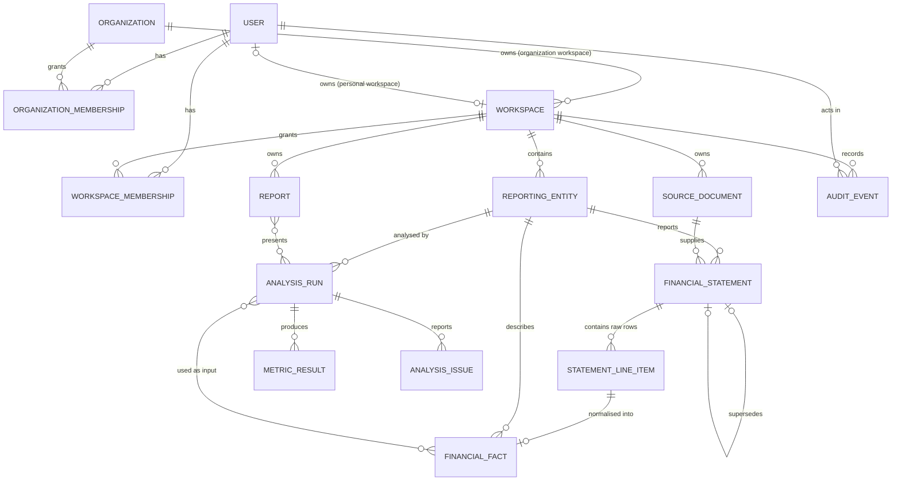

# Data Model

Conceptual and logical data model for Finlume. Status markers:

- **Implemented**: the table exists in a migration today.
- **MVP**: designed for Phase 1, but not yet a model or migration.
- **Future**: direction only; the design will be revisited before implementation.

Physical conventions (types, naming, indexes, constraints) are defined in
[Database conventions](DATABASE_CONVENTIONS.md). Deletion and retention behaviour is in
[Data lifecycle and retention](DATA_LIFECYCLE_AND_RETENTION.md). How the stored numbers are
calculated is in [Financial calculation conventions](FINANCIAL_CALCULATION_CONVENTIONS.md).

## 1. Design principles

1. **Separate domains get separate tables.** Business statements, personal transactions and investment holdings have different rules, permissions and lifecycles. They are not forced into one generic "financial record" table.
2. **The workspace is the tenancy boundary.** Every tenant-owned row is reachable from exactly one workspace, and frequently queried tables carry a direct `workspace` foreign key so authorization filters are simple and indexable.
3. **Raw input is kept separate from normalised facts.** What the user entered or uploaded is stored as-is. Normalised facts are derived from it and point back to it.
4. **Provenance is never broken.** Foreign keys along the provenance chain use Django's `on_delete=RESTRICT`. A source, statement version or fact cannot be deleted while something outside the same deletion still references it. Unlike `PROTECT`, `RESTRICT` still lets a whole workspace (or a user's personal workspace) be deleted in one cascade, because every referencing row is deleted with it. `PROTECT` would raise `ProtectedError` in that case, even inside a correct cascade.
5. **Analysis results are append-only.** A completed analysis run is never edited. A correction produces a new statement version and a new run.
6. **Only what the MVP needs is implemented.** Future entities are documented here so the MVP design does not block them, but they get no tables yet.

## 2. Entity overview

| Entity | Planned app | Status | Purpose |
|--------|-------------|--------|---------|
| `User` | `accounts` | **Implemented** | Authentication identity |
| `Organization` | `organizations` | MVP | Customer boundary; owns organization workspaces |
| `OrganizationMembership` | `organizations` | MVP | User's role in an organization (`admin` or `member`) |
| `Workspace` | `workspaces` | MVP | Tenancy and permission boundary: a user's personal workspace, or an organization workspace |
| `WorkspaceMembership` | `workspaces` | MVP | User's role in a workspace; the only source of workspace access |
| `ReportingEntity` | `financial_records` | **Implemented** (step 2a) | The business, person or company whose statements are analysed |
| `SourceDocument` | `documents` | **Implemented** (step 2a; manual entry only, files in step 4) | Where figures came from: manual entry session or uploaded file |
| `FinancialStatement` | `financial_records` | **Implemented** (step 2a) | One statement for one entity, one period, one version |
| `StatementLineItem` | `financial_records` | **Implemented** (step 2a) | A raw row exactly as entered or uploaded |
| `FinancialFact` | `financial_records` | **Implemented** (step 2a) | A verified, normalised figure in base currency units |
| `AnalysisRun` | `analysis` | MVP | One immutable execution of the calculation engine |
| `MetricResult` | `analysis` | MVP | One metric value produced by a run |
| `AnalysisIssue` | `analysis` | MVP | A validation or calculation issue produced by a run |
| `Report` | `reports` | MVP | A saved, titled view of one or more analysis runs |
| `AuditEvent` | `audit` | MVP | Who did what, when; contains no financial values |
| `Team`, `TeamMembership` | `organizations` | Future | Manage workspace memberships for a group ([ADR-0008](../decisions/ADR-0008-organizations-and-workspace-tenancy.md) §5) |
| `ExtractionCandidate` | `ingestion` | Future (Phase 2) | A value extracted from a PDF, awaiting human review |
| `ExplanationRecord` | `explanations` | Future (Phase 3) | An AI explanation and the stored results it cites |
| Personal finance entities | `personal_finance` | Future (Phase 4) | `Account`, `Transaction`, `Category`, `Budget` |
| Investment entities | `investments`, `market_data` | Future (Phase 5) | `Security`, `Listing`, `PriceBar`, `Portfolio`, `Holding`, `Trade`, provider snapshots |

## 3. Relationships (MVP)



## 4. Entities

Every entity below also has the standard columns from
[Database conventions](DATABASE_CONVENTIONS.md#standard-columns): `id` (internal),
`public_id` (UUID, used in the API), `created_at` and `updated_at`. They are not repeated in
each table. An append-only entity has no `updated_at`.

### 4.1 User (Implemented)

App `accounts`, table `accounts_user`. Extends Django's `AbstractUser`.

| Field | Type | Notes |
|-------|------|-------|
| `id` | bigint PK | Internal; never exposed through the API |
| `public_id` | uuid, unique | API identifier |
| `username` | varchar(150), unique | Django default |
| `email` | varchar(254) | Unique **case-insensitively** through `UniqueConstraint(Lower("email"), name="accounts_user_email_ci_unique")` |
| `password` | varchar(128) | Django password hash; never logged |
| `first_name`, `last_name`, `is_staff`, `is_active`, `is_superuser`, `last_login`, `date_joined` | Django defaults | |

Ownership: a user owns no financial data directly. Data belongs to workspaces, and users act
on it through memberships.

### 4.2 Organization and OrganizationMembership (MVP)

The customer boundary ([ADR-0008](../decisions/ADR-0008-organizations-and-workspace-tenancy.md)).
Any signed-in user may create an organization and becomes its admin. **Organization
membership never grants access to workspace data**, not even for admins.

`Organization`:

| Field | Type | Notes |
|-------|------|-------|
| `name` | varchar(200) | |
| `created_by` | FK → User, `SET NULL`, nullable | |

`OrganizationMembership`:

| Field | Type | Notes |
|-------|------|-------|
| `organization` | FK → Organization, `CASCADE` | |
| `user` | FK → User, `CASCADE` | |
| `role` | varchar(16) | `admin` or `member` (CHECK) |

Constraints: `UNIQUE (user, organization)`, which also serves "my organizations". Application
logic keeps at least one admin.

| Organization role | Manage organization and its members | Create a workspace in it | Read its workspaces |
|---|---|---|---|
| member | | ✓ (becomes owner) | only through workspace membership |
| admin | ✓ | ✓ (becomes owner) | only through workspace membership |

Status, settings and teams are deliberately absent until a feature needs them.

### 4.3 Workspace and WorkspaceMembership (MVP)

The tenancy and permission boundary for all financial data. A workspace is either a user's
**personal workspace** (exactly one per user, created at registration, never shared) or an
**organization workspace**.

`Workspace`:

| Field | Type | Notes |
|-------|------|-------|
| `name` | varchar(200) | |
| `organization` | FK → Organization, `CASCADE`, nullable | Set for organization workspaces |
| `personal_owner` | FK → User, `CASCADE`, nullable, unique | Set for personal workspaces |
| `created_by` | FK → User, `SET NULL`, nullable | |
| `base_currency` | char(3), nullable | Default currency for new statements; display only, no conversion. Added in MVP step 3 |

Constraints: `personal_owner` is `UNIQUE`, and
`CHECK ((organization IS NULL) <> (personal_owner IS NULL))`: exactly one of the two is set.
The kind is derived from which link is set, so there is no `kind` column that could disagree.

`WorkspaceMembership`:

| Field | Type | Notes |
|-------|------|-------|
| `workspace` | FK → Workspace, `CASCADE` | |
| `user` | FK → User, `CASCADE` | |
| `role` | varchar(16) | `owner`, `editor` or `viewer` (CHECK) |

Constraints: `UNIQUE (user, workspace)`. This is the index behind the per-request access
check. Django's FK index on `workspace` serves member lists.

Invariants kept by the application layer, inside transactions
([tenancy plan §3](../development/TENANCY_IMPLEMENTATION_PLAN.md#invariants-enforced-in-use-cases-and-covered-by-tests)):

- A personal workspace has exactly one member, its owner.
- A user is a member of an organization workspace only while they are a member of that organization.
- Every workspace keeps at least one owner.
- Creating a workspace makes its creator the owner in the same transaction.

| Role | Read | Create/edit statements and runs | Manage members | Delete workspace |
|------|------|---------------------------------|----------------|------------------|
| viewer | ✓ | | | |
| editor | ✓ | ✓ | | |
| owner | ✓ | ✓ | ✓ | ✓ (MVP step 8) |

**Why one table for personal and organization workspaces?** Tenancy, membership and audit
rules are the same for both. The domain data they hold differs and lives in separate tables
(for example, personal-finance transactions in Phase 4 never share a table with business
statements).

### 4.4 ReportingEntity (Implemented)

The subject of analysis: the user's own business, a client's business or a researched
listed company.

| Field | Type | Notes |
|-------|------|-------|
| `workspace` | FK → Workspace, `CASCADE` | |
| `name` | varchar(200) | |
| `entity_type` | varchar(16) | `business`, `individual` or `listed_company` (CHECK) |
| `default_currency` | varchar(3), blank when none | Suggested currency for new statements; `''` or `^[A-Z]{3}$` (CHECK) |
| `fiscal_year_end_month` | smallint, nullable | 1–12 (CHECK) |

Constraints: `UNIQUE (workspace, name)` (exact, case-sensitive).

`identifiers` (ticker, ISIN or registration number) is added in Phase 5, when something
interprets it.

### 4.5 SourceDocument (Implemented: manual entry)

Records where figures came from. Every statement has exactly one source.

| Field | Type | Notes |
|-------|------|-------|
| `workspace` | FK → Workspace, `CASCADE` | |
| `kind` | varchar(16) | `manual_entry` (CHECK). `csv_upload` arrives in step 4, `pdf` in Phase 2 and `provider` in Phase 5 |
| `created_by` | FK → User, `SET NULL`, nullable | Who entered or uploaded it. `created_at` is the upload time |

**Added in step 4 with CSV import**, together with the code that writes them: the file
columns `original_filename` (display only, never a storage path), `content_type` (detected
from the content), `size_bytes`, `sha256` (fingerprint of the stored bytes) and
`storage_key` (random key in the `private_documents` storage); the CHECK
`kind = 'manual_entry' OR (sha256 IS NOT NULL AND storage_key IS NOT NULL)`; and the index
`(workspace, sha256)`, which detects re-uploads of the same file (a warning, not a
rejection).

Files are stored only through `PrivateFileSystemStorage`. This is **Implemented**:
`url()` raises `PublicURLNotAllowedError` and files are written with mode `0o600`.

### 4.6 FinancialStatement (Implemented)

One statement type for one entity and one period, at one version.

| Field | Type | Notes |
|-------|------|-------|
| `workspace` | FK → Workspace, `CASCADE` | Denormalised for scoping |
| `entity` | FK → ReportingEntity, `RESTRICT` | |
| `statement_type` | varchar(24) | `income_statement`, `balance_sheet` or `cash_flow` (CHECK) |
| `period_start`, `period_end` | date | `CHECK (period_start <= period_end)`; balance sheet figures are as of `period_end` |
| `period_type` | varchar(16) | `annual`, `half_year`, `quarter`, `month` or `other` (CHECK) |
| `currency` | varchar(3) | ISO 4217, `CHECK (currency ~ '^[A-Z]{3}$')` |
| `reported_scale` | varchar(16) | `units`, `thousands`, `lakhs`, `millions`, `crores` or `billions` (CHECK) |
| `source_document` | FK → SourceDocument, `RESTRICT` | |
| `status` | varchar(16) | `draft` (default), `validated` or `superseded` (CHECK) |
| `version` | integer ≥ 1 | Default 1 |
| `previous_version` | integer, generated (`version - 1`, stored) | Computed by the database; used by the restatement key below |
| `supersedes` | FK → self, `RESTRICT`, nullable, unique | The previous version this one restates: exactly version `version - 1` of the same statement |
| `restatement_reason` | text, blank unless restating | Required when `supersedes` is set, with at least one non-whitespace character, and blank otherwise (CHECK) |

The statement type, period type and scale codes, and the line-item codes below, are taken
from `domain.financial_statements` (`StatementType`, `PeriodType`, `Scale`, `LineItem`),
so the database and the engine share one taxonomy. A change there shows up as a pending
migration.

Constraints:

- `UNIQUE (entity, statement_type, period_start, period_end, version)`.
- **Current versions.** Per (`entity`, `statement_type`, `period_start`, `period_end`), two partial unique indexes allow **at most one `validated` version** (the one analyses use) and **at most one `draft`**. A restatement can therefore be drafted as version *n + 1* while version *n* stays validated and in use. Validating the draft marks version *n* `superseded` in the same transaction (step 3). These indexes cannot be deferred, so version *n* is superseded **before** version *n + 1* is marked validated. Any number of superseded versions may exist. Analyses use the validated version, never a draft.
- `CHECK ((version = 1) = (supersedes IS NULL))`, written as `(version = 1 AND supersedes IS NULL) OR (version > 1 AND supersedes IS NOT NULL)`, plus `CHECK (version >= 1)`.
- A restatement restates exactly the previous version of the same statement: same workspace, entity, statement type and period, and `version - 1`. A version therefore cannot restate itself, skip a version or restate a later one ([cross-row consistency](#cross-row-consistency-postgresql)).

Index: `(workspace, entity, period_end DESC)` for dashboard lookups.

### 4.7 StatementLineItem (Implemented)

A raw input row, exactly as the user provided it.

| Field | Type | Notes |
|-------|------|-------|
| `statement` | FK → FinancialStatement, `CASCADE` | Raw rows belong to their statement version |
| `row_number` | integer ≥ 1 | Order in the source (CHECK) |
| `label` | varchar(255) | Label as entered or as it appeared in the CSV |
| `line_item_code` | varchar(64), blank when unmapped | Mapped canonical code (see the [taxonomy](FINANCIAL_CALCULATION_CONVENTIONS.md#4-line-item-taxonomy-implemented)); `''` or a taxonomy code (CHECK) |
| `reported_amount` | numeric(30,6), nullable | In the statement's `reported_scale`; null when the source cell was blank |
| `raw_value` | varchar(64), may be blank | Original text, kept for audit (for example `"(1,234.5)"`) |
| `source_reference` | varchar(64), may be blank | For example `row 14` or `B14`; later a PDF page/region |

Constraints: `UNIQUE (statement, row_number)`. A partial unique index on
(`statement`, `line_item_code`) where `line_item_code <> ''` ensures a code is mapped
at most once per statement. Whether a code belongs to the statement's type (for example,
`revenue` only on an income statement) is checked by the step 3 input validation.

### 4.8 FinancialFact (Implemented)

A verified, normalised figure. This is the only input the calculation engine accepts.
Persisted facts are loaded into the domain's `FinancialFactSet` (**Implemented**).

| Field | Type | Notes |
|-------|------|-------|
| `workspace` | FK → Workspace, `CASCADE` | |
| `entity` | FK → ReportingEntity, `RESTRICT` | |
| `statement` | FK → FinancialStatement, `RESTRICT` | The exact statement version |
| `line_item` | varchar(64) | Canonical code; a taxonomy code (CHECK) and equal to its raw row's code |
| `period_start`, `period_end`, `period_type` | | Copied from the statement for indexing, and kept equal to it |
| `currency` | varchar(3) | Copied from the statement, and kept equal to it |
| `value` | numeric(30,6) | **Base currency units**, signed according to the sign convention |
| `derived_from` | FK → StatementLineItem, `RESTRICT`, unique | Provenance link, to a mapped row of the same statement |
| `review_status` | varchar(16) | `unreviewed`, `confirmed` or `rejected` (CHECK); manual and confirmed-CSV facts start as `confirmed` |
| `reviewed_by` | FK → User, `SET NULL`, nullable | |
| `reviewed_at` | timestamptz, nullable | |

Constraints: `UNIQUE (statement, line_item)`. Index:
`(entity, line_item, period_end)` for multi-period queries.

### Cross-row consistency (PostgreSQL)

Single-column foreign keys cannot keep related rows in one workspace. Django 5.2 has no
composite foreign keys, so migrations `financial_records.0002` and `0003` add them in SQL on
PostgreSQL. Each one references a `*_key` unique constraint declared on the target model:

| Constraint | Columns → referenced columns | Guarantees |
|---|---|---|
| `…financialstatement_entity_same_workspace` | `(workspace, entity)` → entity `(workspace, id)` | A statement's entity is in its workspace |
| `…financialstatement_source_same_workspace` | `(workspace, source_document)` → document `(workspace, id)` | Its source document is too |
| `…financialstatement_supersedes_same_key` | `(workspace, entity, statement_type, period_start, period_end, previous_version, supersedes)` → statement `(…, version, id)` | A restatement restates the previous version of the same statement (migration `0003`) |
| `…financialfact_matches_statement` | `(workspace, entity, period_start, period_end, period_type, currency, statement)` → statement | A fact's copied columns equal its statement's, so a statement with facts cannot change them |
| `…financialfact_derived_from_same_statement` | `(statement, derived_from, line_item)` → line item `(statement, id, line_item_code)` | A fact derives from a mapped row of its own statement, with the same code |

A line item has no `workspace` column. It reaches its workspace through its statement, and
the last key keeps its fact in the same one.

The keys are `DEFERRABLE INITIALLY DEFERRED`, like Django's own foreign keys, and use
`ON DELETE NO ACTION`. Django's `RESTRICT` handling decides what may be deleted, and a
workspace cascade can remove rows in any order within its transaction. They are checked
at commit, or earlier with `SET CONSTRAINTS ALL IMMEDIATE`, which is what
`connection.check_constraints()` does. SQLite, which is never used for real data, does not
get them.

### 4.9 AnalysisRun (MVP)

One execution of `domain.calculations.run_statement_analysis` (**Implemented**). Completed
runs are immutable.

| Field | Type | Notes |
|-------|------|-------|
| `workspace` | FK → Workspace, `CASCADE` | |
| `entity` | FK → ReportingEntity, `RESTRICT` | |
| `period_start`, `period_end`, `period_type`, `currency` | | The fact set's period and currency |
| `engine_version` | varchar(32) | `ENGINE_VERSION` at run time, currently `0.1.0` |
| `input_fingerprint` | char(64) | SHA-256 of the canonicalised input facts (see [conventions](FINANCIAL_CALCULATION_CONVENTIONS.md#10-reproducibility-and-versioning)) |
| `status` | varchar(16) | `completed` or `failed`; `pending` and `running` are reserved for background jobs |
| `created_by` | FK → User, `SET NULL` | |
| `completed_at` | timestamptz, nullable | |

A join table `analysis_run_input_fact (run, fact)` with `RESTRICT` on `fact` records exactly
which facts were used. Index: `(workspace, entity, created_at DESC)`, plus a non-unique index
on `(entity, input_fingerprint, engine_version)` to find equivalent runs.

### 4.10 MetricResult (MVP)

| Field | Type | Notes |
|-------|------|-------|
| `run` | FK → AnalysisRun, `CASCADE` | |
| `metric_code` | varchar(64) | For example `gross_margin` |
| `value` | numeric(24,6), nullable | Null means not computable |
| `unit` | varchar(16) | `ratio` |
| `methodology` | text | Copied from the definition at run time |
| `inputs` | jsonb | `{line_item_code: "decimal string"}`; decimals are stored as strings, never as JSON floats |

Constraints: `UNIQUE (run, metric_code)`.

### 4.11 AnalysisIssue (MVP)

| Field | Type | Notes |
|-------|------|-------|
| `run` | FK → AnalysisRun, `CASCADE` | |
| `metric_code` | varchar(64), nullable | Null for validation issues that apply to the whole fact set |
| `code` | varchar(64) | `IssueCode` value, for example `balance_sheet_imbalance` |
| `severity` | varchar(16) | `info`, `warning` or `error` |
| `message` | text | |
| `line_items` | jsonb | List of line-item codes |

### 4.12 Report (MVP)

| Field | Type | Notes |
|-------|------|-------|
| `workspace` | FK → Workspace, `CASCADE` | |
| `title` | varchar(200) | |
| `notes` | text | User commentary, clearly separated from calculated values |
| `runs` | M2M → AnalysisRun (`RESTRICT` on run) | Ordered via the join table's `position` |
| `created_by` | FK → User, `SET NULL` | |

The MVP renders reports live from stored runs. Exported PDFs or images are generated on
demand and are not stored.

### 4.13 AuditEvent (MVP)

Append-only. Never contains financial values, document contents or credentials.

| Field | Type | Notes |
|-------|------|-------|
| `occurred_at` | timestamptz | |
| `actor` | FK → User, `SET NULL`, nullable | Pseudonymised when the account is deleted |
| `actor_label` | varchar(64) | A stable pseudonym, so events stay attributable after deletion |
| `workspace` | FK → Workspace, `SET NULL`, nullable | |
| `action` | varchar(64) | For example `statement.created`, `analysis.run`, `membership.role_changed`, `organization.member_removed`, `workspace.ownership_recovered`, `auth.login_failed` |
| `target_type` | varchar(64) | For example `financial_statement` |
| `target_public_id` | uuid, nullable | |
| `request_id` | varchar(64) | Matches the `X-Request-ID` response header |
| `metadata` | jsonb | Non-financial context only, for example `{"version": 2}` |

Index: `(workspace, occurred_at DESC)`, `(actor, occurred_at DESC)`.

## 5. Provenance chain

```text
Source → Extracted value → Validation/review → Normalised financial fact → Versioned calculation → Result
```

| Step | MVP representation | Key guarantee |
|------|--------------------|---------------|
| Source | `SourceDocument` (manual entry session or CSV file with SHA-256) | The original bytes are kept privately and fingerprinted |
| Extracted value | `StatementLineItem` (`raw_value`, `reported_amount`, `source_reference`) | The input is kept verbatim; nothing is overwritten |
| Validation/review | Mapping review, domain validation issues, `FinancialFact.review_status` | Only confirmed facts feed calculations |
| Normalised fact | `FinancialFact.value` in base units, linked by `derived_from` | Normalisation is exact (`normalize_amount`) |
| Versioned calculation | `AnalysisRun` (`engine_version`, `input_fingerprint`, input fact links) | Same inputs and version give the same output |
| Result | `MetricResult`, `AnalysisIssue` | Each result carries its methodology and input values |

Phase 2 (PDF) adds `ExtractionCandidate` between Source and Extracted value: page, bounding
region, extractor name and version, and confidence. Candidates become `StatementLineItem`
rows only after a human confirms them.

## 6. Handling financial data specifics

| Concern | MVP rule |
|---------|----------|
| **Currency** | One ISO 4217 currency per statement. Facts and runs carry the currency. The engine never mixes currencies, and there is no FX conversion (decision D-03). |
| **Units and scales** | `reported_amount` stays in the reported scale. `FinancialFact.value` is always in base units, converted exactly by powers of ten. |
| **Reporting periods** | Explicit start and end dates plus a period type. Balance sheet facts are as of `period_end`. An analysis combines facts with identical period bounds only. |
| **Missing data** | An absent fact means unknown. It is never stored or treated as zero. Blank cells give `reported_amount = NULL` and no fact. |
| **Restatements** | A new `FinancialStatement` version with `supersedes` and a reason, drafted while the previous version stays validated. Old facts and runs stay intact. New analyses use the latest **validated** version, never a draft restatement. |
| **Rounding** | Inputs are stored exactly as given, up to 6 decimal places. Results are quantised to 6 decimal places with half-even rounding. Display rounding happens in the client only. |
| **Reconciliation** | Validation checks (balance sheet identity and gross-profit subtotal, with 0.1 % relative tolerance) produce persisted `AnalysisIssue` warnings. They never auto-correct data. |

## 7. Future entities (direction only)

These get no tables until their phase begins, and each lives in its own app with its own
rules.

- **Personal finance (Phase 4):** `Account` (bank, card, cash, loan; currency), `Transaction` (date, amount, description, category, import batch, source row reference), `Category` (hierarchical, per workspace), `Budget`. Imported transactions follow the same provenance pattern: an import file as a `SourceDocument` and raw rows kept.
- **Bank feeds (unscheduled):** connection metadata only. Any credentials or tokens stay with a provider and are never stored in plaintext.
- **Investments (Phase 5):** `Security`, `Listing` (exchange, ticker), `PriceBar` (date, OHLC, currency, provider), `Portfolio`, `Holding`, `Trade`. Market data is shared reference data, not tenant data. It is held in separate tables with provider provenance and licence notes.
- **AI explanations (Phase 3):** `ExplanationRecord` (run, provider, model, prompt template version, output text, cited `MetricResult` IDs, created_by). An explanation can only cite stored results.
- **Background work (Phase 2):** `ImportJob` or extraction-job records if they become necessary.
